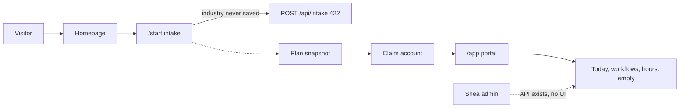

# ATG Consulting — audit and next-agent handoff

Read this file before changing code. It is the source of truth for the next pass. When it disagrees with [replit.md](../replit.md) or [docs/CURSOR_BUILD_PROMPT.md](CURSOR_BUILD_PROMPT.md), follow the code and this file.

ATG is one product with levels of customization and human involvement. The code today is a consulting portal whose workbench promises workflows and does not run one yet.

1. **Self-serve** (`SELF_SERVE`): the client runs ready-made workflows in the workbench (the first one is "Draft a follow-up") and reviews or approves the output themselves. Templates, learn modules, light customization. Shea is an upgrade path, not the operator.
2. **Guided** (`GUIDED`): the same workbench, plus Shea tunes their workflows, reviews outputs, and they get scheduled 1:1 consults and the operator message thread.
3. **Done-for-you** (`WHITE_GLOVE` in the schema; "White glove" on [Tiers.tsx](../artifacts/atg-consulting/src/components/sections/Tiers.tsx)): Shea designs, builds, runs, and tunes custom workflows. The client mostly approves finished output.

`NONE` means no plan yet. Treat it like self-serve for gating: they can run the ready-made workflow, and Shea features show an upgrade prompt. Keep all three prices as `[$ placeholder]`.

The follow-up draft is the **first workflow**, not the audience. ATG serves anyone who is not tech or AI savvy, across all six verticals in [verticals.ts](../artifacts/atg-consulting/src/content/verticals.ts) (`trades`, `realestate`, `hospitality`, `professional`, `salesrep`, `solo`). Do not narrow homepage, intake, or tier copy to sales reps.

The public intake snapshot stays high-level ("where you are today, how we can help"). Full detail stays in the admin prep view for Shea's 1:1.



## Stack (what is actually running)

- Frontend: Vite + React + wouter in [artifacts/atg-consulting](../artifacts/atg-consulting). Routes are in [artifacts/atg-consulting/src/App.tsx](../artifacts/atg-consulting/src/App.tsx).
- API: Express + Prisma + PostgreSQL in [artifacts/api-server](../artifacts/api-server). Schema: [artifacts/api-server/prisma/schema.prisma](../artifacts/api-server/prisma/schema.prisma). There is no migrations folder; schema is applied with `pnpm db:push`.
- Auth: Clerk. Admin is any verified email in `ADMIN_EMAILS` (default `shea@atgconsulting.io`). Adapter: [artifacts/api-server/src/lib/auth.ts](../artifacts/api-server/src/lib/auth.ts).
- `lib/db` is an unused Drizzle stub. Do not build on it.
- [artifacts/mockup-sandbox](../artifacts/mockup-sandbox) is an empty component canvas. Do not put product UI there.
- Design tokens that match the live site are in [docs/DESIGN_SYSTEM.md](DESIGN_SYSTEM.md): Geist, ink/canvas, blue `#3B6BFF`, button `#2557E8`. The build prompt’s navy/orange palette is stale.
- There is no Replit agent and no managed-workflow restart in this environment. Deliver the work as a pull request against `main`. Do not start a second Vite or API process, and do not bind `127.0.0.1`.
- Verify with typecheck and tests. Put a short manual QA checklist in the PR description for Shea to run after merging, `pnpm db:push`, and republishing. Say in the PR whether `db:push` is required. This pass does not change the Prisma schema, so `db:push` is not required unless a later edit adds columns.

Stale docs to ignore when they conflict:

- [replit.md](../replit.md) still describes SQLite, a three-step intake, no claim, and no admin.
- [docs/CURSOR_BUILD_PROMPT.md](CURSOR_BUILD_PROMPT.md) still describes Next.js, Replit Auth, and `/login`. Live auth is Clerk at `/sign-in` and `/sign-up`.

## Where we are

### Public site

`/` ([artifacts/atg-consulting/src/pages/home.tsx](../artifacts/atg-consulting/src/pages/home.tsx)) is a real page: Hero, WhoWeHelp, OutputGallery, Calculator, ChatVsATG, HowItWorks, SheaOperator, Tiers, FAQ, CTA, Footer. Signed-in users with no URL hash are redirected to `/app`.

| Route | File | State |
|---|---|---|
| `/` | `src/pages/home.tsx` | Real marketing page. Several targets and strings are still placeholders. |
| `/start` | `src/pages/start.tsx` + `src/components/intake/IntakeForm.tsx` | Real 13-question form. Submit fails. See intake bug below. |
| `/start/result/:intakeId` | `src/pages/plan-result.tsx` | Real. `GET /api/plan/:intakeId` is public for 7 days, then 410 unless owner or admin. |
| `/sign-in`, `/sign-up` | `src/pages/auth.tsx` | Real Clerk widgets. |
| `/app/*` | `src/pages/app/*` | Signed-in portal. See below. |
| `/admin/*` | `src/pages/admin/*` | Admin console. |
| anything else | `src/pages/not-found.tsx` | Developer 404: “Did you forget to add the page to the router?” |

Broken or unfinished on the public page:

- Nav “Services” and the command palette scroll to `#services`. The only component with that id is [Services.tsx](../artifacts/atg-consulting/src/components/sections/Services.tsx), and [home.tsx](../artifacts/atg-consulting/src/pages/home.tsx) does not mount it. `#how-it-works` and `#about` (on SheaOperator) do exist.
- [Services.tsx](../artifacts/atg-consulting/src/components/sections/Services.tsx) contains invented time stats (“Typical: 2h → 5 min”). If you mount it, replace those with plain descriptions. Do not ship made-up numbers.
- Prices are the literal `[$ placeholder]` in [Tiers.tsx](../artifacts/atg-consulting/src/components/sections/Tiers.tsx). FAQ cost, timeframe, and upgrade credit are still bracket placeholders in [FAQ.tsx](../artifacts/atg-consulting/src/components/sections/FAQ.tsx). Leave them until Shea supplies real values.
- Founder personal line in [src/content/shea.ts](../artifacts/atg-consulting/src/content/shea.ts) is still a bracket note. Photo path `/brand/shea.jpg` has no file; [SheaOperator.tsx](../artifacts/atg-consulting/src/components/sections/SheaOperator.tsx) shows initials.
- Footer LinkedIn uses `VITE_LINKEDIN_URL`, or the string `[LinkedIn]` if unset ([Footer.tsx](../artifacts/atg-consulting/src/components/sections/Footer.tsx)). Privacy points at `/privacy`, which 404s. There is no `/terms` route.
- Booking CTAs use `VITE_BOOKING_URL`, else `#book`. Nothing has `id="book"`. `.env.example` points at `https://cal.com/shea-atg/30min`. Self-serve “Join the seminar” and Guided “Save my spot” both go to `/start`. There is no seminar, template library, or community page.
- Mobile nav ([Nav.tsx](../artifacts/atg-consulting/src/components/Nav.tsx) around the `md:hidden` menu) has the three anchors and “Map my workflow”. It does not include Sign in. Desktop nav does.
- Output gallery Approve / Edit / Dismiss have no handlers. The samples are labeled fictional on purpose. Do not turn them into fake testimonials.
- Intake text fields have no `<label>` or `aria-label`.

Unmounted leftovers (do not revive unless a task below says so): `About.tsx`, `Problem.tsx`, `WhoItsFor.tsx`, `WhatWeAutomate.tsx`, `Example.tsx`, `CompareTable.tsx`, and the old three-step intake components.

### Intake bug (the funnel is broken)

[IntakeForm.tsx](../artifacts/atg-consulting/src/components/intake/IntakeForm.tsx) asks “What type of business is it?” with `key: "industry"`. Options are vertical ids from [verticals.ts](../artifacts/atg-consulting/src/content/verticals.ts): `trades`, `realestate`, `hospitality`, `professional`, `salesrep`, `solo`.

`handleOption` only writes `bizSize`, `aiComfort`, and `preferredHelp`. `industry` stays `""`. `currentRadioValue` also ignores `industry`, so the chosen option never looks selected. `validate()` does not require an industry pick, so the radio auto-advances.

[artifacts/api-server/src/routes/intake.ts](../artifacts/api-server/src/routes/intake.ts) requires `industry: z.string().min(1)`. A finished form returns 422 `"Validation failed."` Area values on the form already match the API enum: `executive_assistant`, `marketing`, `sales`, `customer_support`.

`POST /api/intake` otherwise works: Zod, honeypot, 5 per 15 minutes per IP (in-memory), writes `Intake`, `Plan`, and legacy `IntakeSubmission`, returns `{ ok, intakeId, planId, snapshot }`. If the honeypot is filled, the API returns `{ ok: true }` with no `intakeId`, and the client navigates to `/start/result/undefined`. Leave the honeypot behavior; do not navigate when `intakeId` is missing.

The only model call in the product is `generateBothOutputs` in [llm.ts](../artifacts/api-server/src/lib/llm.ts), invoked from that intake route. OpenAI-compatible chat completions, model `LLM_MODEL` or `gpt-4o-mini`, 20s timeout. Keys: `OPENAI_API_KEY`, else `XAI_API_KEY`, else `LLM_API_KEY`, optional `LLM_BASE_URL`. No key or a failed call falls back to a template (`source: "TEMPLATE"`). The client prompt forbids steps and tool names. That is intentional for the public snapshot. Do not put implementation steps on the public plan page.

Existing test: [artifacts/api-server/src/intake.test.ts](../artifacts/api-server/src/intake.test.ts). It already posts an intake and expects 200, but `industry` is `"Consulting"` rather than a vertical id, and the whole test **skips** when `DATABASE_URL` is Postgres (this Replit). Update that fixture to `salesrep` and assert that `industry: ""` returns 422. Do not flip the Prisma provider back to SQLite to make the test run.

### Auth and portal

- `/app/*` is gated in [AppShell.tsx](../artifacts/atg-consulting/src/components/app/AppShell.tsx). Unsigned users go to `/sign-in`.
- Client nav: Dashboard, Consultations, Documents, Reports, Learn, Account.
- Dashboard ([dashboard.tsx](../artifacts/atg-consulting/src/pages/app/dashboard.tsx)) tabs: Today, My workflows, Hours saved, plus a “request a workflow” form and [OperatorPanel](../artifacts/atg-consulting/src/components/workbench/OperatorPanel.tsx) (a human thread with Shea, not a model).
- `/admin/*` requires `account.isAdmin`. Pages: clients, intakes, reports, content (learn modules only), audit, messages.
- `POST /api/plan/:intakeId/claim` in [plan.ts](../artifacts/api-server/src/routes/plan.ts) creates a `Client` (tier `NONE`) and `WorkflowItem` checklist rows from focus-area names. It does **not** check that the signed-in email matches the intake email. Any signed-in user who knows the id can claim it inside 7 days.
- Workbench routes 404 with “No client profile. Complete the intake first.” when `user.clientId` is null. A signed-in user who has not claimed a plan cannot generate a draft until they have a `Client` row.
- Account ([account.tsx](../artifacts/atg-consulting/src/pages/app/account.tsx)) reads `useAccount` → `GET /api/account`. That handler ([account.ts](../artifacts/api-server/src/routes/account.ts)) omits `tier` and `digestEmailOptIn`. The page still indexes `TIER_LABELS[account.tier]`, so the plan label is blank. `GET /api/client/me` ([client.ts](../artifacts/api-server/src/routes/client.ts)) already returns `tier`, `status`, and `digestEmailOptIn`, and it does not 404 when there is no client (`tier: "NONE"`).
- `GET /api/client/dashboard` and `PATCH /api/client/workflow/:id` exist. No page calls them. `WorkflowItem` rows from claim are invisible.

### AI, email, billing, files

- `PromptTemplate` has admin API routes. [llm.ts](../artifacts/api-server/src/lib/llm.ts) never reads them. The content admin UI does not edit prompts.
- Daily reports ([reports.ts](../artifacts/api-server/src/lib/reports.ts)) are template text. `POST /api/cron/daily-reports` (header `x-cron-secret`) writes one draft per `ACTIVE` client per server-local date. The comment says Denver; the code does not set that timezone. Publish does not email. `sendDigestEmail` in [email.ts](../artifacts/api-server/src/lib/email.ts) is never called. Default transport is console (`sent: false`). Intake alerts send only when `EMAIL_SEND_INTAKE_ALERTS=true`.
- No Stripe. `Client.stripeCustomerId` is unused. Account copy says billing is managed by Shea. Leave it that way until prices exist.
- Documents: list and signed download work. No upload UI. Plan PDF fields exist and nothing generates a PDF. Local file serving returns 403 in production. S3 and Replit drivers are a TODO in [storage.ts](../artifacts/api-server/src/lib/storage.ts).
- No privacy page, terms page, data export, or account delete.
- OpenAPI in `lib/api-spec` only documents `/healthz`, `/account`, and an old intake shape. Do not regenerate the contract unless you are also updating the spec. The live intake response is `{ ok, intakeId, planId, snapshot }`.

### Agent data model is a shell

These models exist and are unused by any generator:

- `Workflow` — `area` is `ea | marketing | sales | cs`, `status` is `designing | building | live | paused`, `schedule`, `lastRunAt` (never written), `setupNote`.
- `WorkflowRun` — nothing inserts a row. Hours saved counts these.
- `OutputItem` — `type` is `briefing | email_draft | lead_list | social_post | quote_followup | review_request`, `status` is `pending | approved | edited | dismissed`.
- `WorkflowRequest` — the dashboard “request a workflow” form writes these. Admin can update status.

Client routes that already work ([workbench.ts](../artifacts/api-server/src/routes/workbench.ts)):

- `GET /api/workbench/today` — pending outputs for the signed-in client
- `PATCH /api/workbench/output/:id` — body `{ action: "approve" | "edit" | "dismiss", editedContent? }`
- `GET /api/workbench/workflows`
- `GET /api/workbench/hours-saved` — `{ runs, approved, totalRuns }` from completed `WorkflowRun` rows
- messages and `POST /api/workbench/requests`

Admin routes that exist and have no UI ([admin.ts](../artifacts/api-server/src/routes/admin.ts), registered on the same router after `export default`):

- `POST /api/admin/clients/:id/workflows` — requires `name`, `description`, `area`
- `PATCH /api/admin/workflows/:id` — passes `req.body` straight into Prisma. Validate fields before this pass ends.
- `POST /api/admin/clients/:id/outputs` — requires `workflowId`, `type`, `subject`, `content`. Does not check that the workflow belongs to that client. Fix that when you add the form.

Frontend client: `api.workbench.*` in [artifacts/atg-consulting/src/lib/api.ts](../artifacts/atg-consulting/src/lib/api.ts). [TodayInbox.tsx](../artifacts/atg-consulting/src/components/workbench/TodayInbox.tsx) already calls review. On approve/edit/dismiss it removes the card, so the user cannot copy the draft. Change that for approve and edit.

Empty-state copy that overclaims, and must change:

- Today: “New outputs from your workflows will appear here when they run.”
- My workflows: “Shea is working on your setup.”
- Hours saved: “Shea logs every run and you'll see what's been handled for you here.”

Replacement copy depends on tier. Never claim Shea is already logging runs.

- Guided and White glove: “Nothing has run yet. Draft your first follow-up — Shea will help tune it from there.”
- Self-serve and no plan yet: say nothing has run yet, offer “Draft a follow-up”, and add “Want Shea to set this up for you?” linking to the consult path (`/app/consultations`).

Gate operator features by tier. [OperatorPanel](../artifacts/atg-consulting/src/components/workbench/OperatorPanel.tsx) messaging and the “request a workflow” form are for Guided and White glove only. Self-serve and `NONE` see the upgrade prompt instead of a message box that looks live.

The first ready-made workflow is “Draft a follow-up” (`email_draft`, area `sales`). It is available to every vertical. Prospect lists, marketing posts, and CRM logging stay copy until a later pass.

## Do not

- Invent prices, testimonials, client names, stats, or hours-saved figures. Leave `[placeholder]` until Shea supplies the value.
- Send email, post to social, or write to a CRM. Approve means the draft is ready to copy.
- Add Stripe, S3, a new auth provider, or extra agents (marketing, inbox, lead lists) in this pass.
- Add custom RPC URLs or a swap widget.
- Start a replacement `vite` / `pnpm dev` process, or pretend a Replit preview restart is available.
- Narrow homepage, intake, or tier copy to sales reps. The follow-up draft is the first workflow, not the audience.
- Put implementation steps or tool names on the public intake snapshot. `CLIENT_SYSTEM_PROMPT` forbids them on purpose. Full detail stays in the admin prep view.

## P0 — the site must be usable

Do these before the draft workflow.

1. **Save industry.** In `handleOption`, when `q.key === "industry"`, set `data.industry`. Include it in `currentRadioValue`. In `validate()`, if the current question is the industry radio and `data.industry` is empty, set an error and do not advance. Vertical ids only (`trades`, `realestate`, `hospitality`, `professional`, `salesrep`, `solo`).
2. **Test.** In [intake.test.ts](../artifacts/api-server/src/intake.test.ts), send `industry: "salesrep"` on the happy-path body and assert `industry: ""` returns 422. The test skips on Postgres; still update it. Do not switch the database provider.
3. **Services anchor.** Mount a services section on the homepage so `/#services` lands on executive assistant, marketing, sales, and customer replies in plain language. Reuse [Services.tsx](../artifacts/atg-consulting/src/components/sections/Services.tsx) only after removing invented durations (“Typical: 2h → 5 min” and similar). The command palette already scrolls to `#services`.
4. **404.** Replace the developer not-found page with a short page that links to `/` and `/start`, using the ink/canvas tokens, not default gray/red.
5. **Privacy and terms.** Add `/privacy` and `/terms` routes. Short drafts titled as waiting for Shea’s review. State that intake answers, including free text, can be sent to the configured model provider (OpenAI-compatible; key may be OpenAI or xAI) to write the snapshot, and that Shea can see the intake in the admin console. Do not present the pages as finished legal advice. Point the footer Privacy link at the new route. Add a Terms link beside it.
6. **Mobile nav.** In the `md:hidden` menu, add Sign in when signed out and Dashboard (`/app`) when signed in, matching the desktop nav.
7. **Honest empty states.** Today, My workflows, and Hours saved must say nothing has run yet and point at “Draft a follow-up” (P1). For Guided and White glove, add “Shea will help tune it from there.” For self-serve and `NONE`, add “Want Shea to set this up for you?” linking to `/app/consultations`. Never claim Shea is already logging runs. Hide OperatorPanel and workflow requests unless the tier is `GUIDED` or `WHITE_GLOVE`.
8. **Account tier.** Change [useAccount.ts](../artifacts/atg-consulting/src/lib/useAccount.ts) to `api.client.me()`, or add `tier` and `digestEmailOptIn` to `GET /api/account` by loading the client. The Account page must show “No plan yet” for tier `NONE`, not a blank label.
9. **Claim matches email.** In `POST /api/plan/:intakeId/claim`, allow the claim when the user’s verified email (lowercased) equals the intake email, or when `user.role === "ADMIN"`. Otherwise 403. If the user has no email, 403 with a message to add an email. Keep the 7-day window and the already-claimed short-circuit.

## P1 — first ready-made workflow

The first workflow is “Draft a follow-up”, for every vertical, not a sales-rep-only product. Plain labels. No “agent” jargon in the UI. Shea stays in the story only where the tier includes him.

### Client flow

- Primary button on the empty Today inbox: “Draft a follow-up”. The same action is available when the inbox already has items.
- Form fields: who they are writing to, what happened last (last call, email, or visit), and what they want to say. All required, length-capped, with visible labels.
- Submit only when the user has a `Client` row. If not, say they need to finish the intake and save the plan, and link to `/start`.
- Server creates:
  - one `Workflow` for that client if they do not already have one named for this job (`area: "sales"`, `status: "live"`, a one-line description). Set `lastRunAt` on each run.
  - one `WorkflowRun` with `status: "completed"`, `outputCount: 1`, and a summary like “Follow-up draft ready”.
  - one `OutputItem` with `type: "email_draft"`, `status: "pending"`, `subject` set to a short subject line, `content` set to the draft body.
- Generation: add a function next to the intake helper in [llm.ts](../artifacts/api-server/src/lib/llm.ts). Use the existing OpenAI-compatible client, a 20s timeout, and `response_format: json_object`. Validate the JSON with Zod (`subject`, `body`). On missing key, timeout, or invalid JSON, use a deterministic template that quotes the user’s own words and does not invent facts about the recipient. Wrap user text with the existing `promptSafe` helper and truncate it. Do not log the raw text. Do not give the model tools.
- The draft is a normal email the user could paste into their own mail app. No tracking pixels, no “sent by AI” footer unless the user asked for one.
- Reuse `PATCH /api/workbench/output/:id`. After approve or edit, keep the card on screen and say the draft is ready to copy, with the final text (`editedContent` if present, otherwise `content`) and a copy control. Dismiss removes it. Approving does not send email and does not create a second run.
- Hours saved will show `totalRuns >= 1` after one draft. Do not convert runs into a made-up hour count. The ledger already shows run count and approved count.

Suggested route: `POST /api/workbench/follow-up` on the existing workbench router, Zod body `{ who, lastTouch, wantToSay }`, auth and `clientId` required. Add `api.workbench.draftFollowUp` in [api.ts](../artifacts/atg-consulting/src/lib/api.ts).

### Admin

On the admin client detail page ([artifacts/atg-consulting/src/pages/admin/clients.tsx](../artifacts/atg-consulting/src/pages/admin/clients.tsx)), add a small form: pick or create a workflow, then type, subject, and content. Post to `POST /api/admin/clients/:id/outputs`.

Harden the two admin handlers in the same change:

- `POST /outputs` must confirm `workflowId` belongs to `:id`.
- `PATCH /admin/workflows/:id` must accept only `name`, `description`, `area`, `status`, `schedule`, `setupNote`, with Zod, and ignore everything else.

## P2 — later, not this pass

- Seed 2–3 learn modules for the follow-up workflow at the self-serve tier.
- Wire the existing admin document upload, then a plan PDF.
- On report publish, call `sendDigestEmail` when `digestEmailOptIn` is true and email is configured. Set the cron date in `America/Denver`.
- Prompt-template editor that `llm.ts` actually loads.
- Production booking CTAs must use a real `VITE_BOOKING_URL`. No dead `#book`.
- Security headers, an IDOR test (client A cannot read client B’s output, consultation, or document), and a rate limiter that survives more than one process.
- Stripe stays behind `BILLING_ENABLED` until Shea sets prices.
- Further workflows (prospect list, marketing post, morning briefing) only after this follow-up draft is usable. Same rule: the user reviews before anything leaves the app.

## Leave for Shea

Do not guess these:

- The three tier prices, and whether self-serve is a seminar or the in-app draft button. This pass ships the in-app draft. Tier cards can keep `[$ placeholder]`.
- Booking URL, LinkedIn URL, founder photo, and the personal line in `shea.ts`.
- Final privacy and terms wording. Ship the drafts marked for review.
- Whether a later version may send mail or touch a CRM. Until Shea says otherwise, the product copies a draft and stops.

## Verify before you stop

Run typecheck and the API tests. Do not treat a skipped Postgres intake test as a failure, and do not switch the database provider to make it run. A follow-up template test that does not touch the database should actually run.

Open a pull request against `main`. The description includes this manual QA list for Shea, after merge, `pnpm db:push` only if the schema changed, and a republish:

1. Complete `/start`, including a business type, and land on `/start/result/:id` (not an error, not `undefined`).
2. Open `/#services` from the nav and land on the four lanes. No invented hour counts.
3. Open `/privacy` and `/terms` from the footer. Open a bad URL and see a real not-found page with a way home.
4. On a narrow viewport, open the menu and see Sign in.
5. As a signed-in user whose email matches an intake, claim the plan. A different email gets 403. Open Account and see a tier label (“No plan yet” is correct).
6. On the dashboard, as self-serve or no plan, draft a follow-up, edit it, approve it, and copy the text. Hours saved shows at least one run. The message box to Shea is an upgrade prompt, not a live thread. Nothing is emailed.
7. As admin, set the client to Guided and confirm the operator thread and workflow request appear. Add an output for that client and see it in their Today list.

## Prompt

```text
You are continuing ATG Consulting in /home/runner/workspace. Read docs/NEXT_AGENT.md and follow it. The app is Vite + wouter (artifacts/atg-consulting) and Express + Prisma (artifacts/api-server), with Clerk. Ignore stale claims in replit.md and docs/CURSOR_BUILD_PROMPT.md when they disagree with the code.

Goal of this pass: a visitor in any vertical can finish /start, land on a plan, and a signed-in client can generate one follow-up email draft, review it, and see it count as a workflow run. ATG is one product: Self-serve runs that workflow, Guided and White glove (WHITE_GLOVE) also get Shea as operator. Do not narrow homepage, intake, or tier copy to sales reps. Do not send email, post to social, connect a CRM, add Stripe, or invent prices, testimonials, or stats.

Do these in order:
1. Fix intake so industry (a vertical id from src/content/verticals.ts) is stored, visible as selected, and required. POST /api/intake must succeed for a valid body. Update artifacts/api-server/src/intake.test.ts so the happy path uses industry "salesrep" and an empty industry returns 422. That test skips when DATABASE_URL is Postgres; still update it. Do not switch the database back to SQLite.
2. Make /#services reach a mounted services section. If you mount Services.tsx, remove invented durations such as "Typical: 2h → 5 min". Replace the developer 404. Add draft /privacy and /terms pages (marked for Shea's review, stating that intake text can be sent to the configured model provider) and keep the footer link. Add Sign in or Dashboard to the mobile nav. Show the client's real tier on Account via GET /api/client/me or by adding tier to GET /api/account. Only claim a plan when the verified email matches the intake, unless the user is admin.
3. Add a workbench "Draft a follow-up" flow (POST /api/workbench/follow-up) that creates a pending email_draft OutputItem, a sales Workflow if missing, and one WorkflowRun, using the existing LLM helper with a template fallback and Zod-validated JSON. Reuse PATCH /api/workbench/output/:id. After approve or edit, keep the draft on screen and say it is ready to copy. Do not send it. Empty states on Today, My workflows, and Hours saved must point at this action. Guided and White glove copy may say Shea will help tune it from there. Self-serve and NONE get "Want Shea to set this up for you?" linking to /app/consultations. Never claim Shea is already logging runs. Show OperatorPanel and workflow requests only for GUIDED and WHITE_GLOVE. Add an admin form on the client detail page that posts an output through POST /api/admin/clients/:id/outputs. Confirm the workflow belongs to that client. Validate PATCH /api/admin/workflows/:id instead of passing req.body into Prisma.
4. Run typecheck and tests. Deliver a PR against main. Replace browser verification with a manual QA checklist in the PR description that Shea runs after merging, pnpm db:push, and republishing. Note in the PR if db:push is required. Do not start a second Vite or API process. There is no Replit agent and no managed-workflow restart.

Leave prices, founder photo, LinkedIn, and booking copy as placeholders if the real values are not in env. Do not expand into billing, S3, or extra agents in this pass.
```
